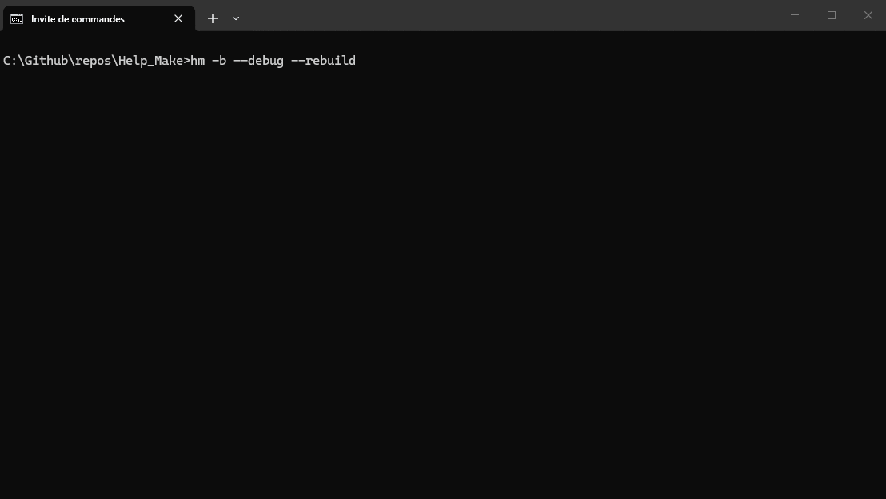

# HelpMake (hm)

**One plain-text file. C, C++, Zig, Go. Windows, Linux, macOS.**

[](https://opensource.org/licenses/MIT)
[](https://isocpp.org/)
[]()
[](https://github.com/Gag91/Help_Make/releases)
[](https://github.com/Gag91/Help_Make/stargazers)
HelpMake is a build system for people who think CMake is too much and Make is too little.


One file - `HelpMake.txt` - describes your whole build. Run `hm -b` and you get an executable, a static library, or a test suite. No generator step, no `CMakeLists.txt` hierarchy, no `configure` scripts, no shell-quoting footguns. Just a file and a command.

```txt
Compiler: g++
Version: std=c++20
Output: build/app.exe
InputFiles { src/**/*.cpp }
Includes { include }
Flags { -Wall -O2 linux: -pthread win: /W4 }
```

```bash
hm -b           # build
hm -b -w -r     # rebuild on save + run after every build
hm -b --dry-run # preview build commands without executing them
hm test         # run every config marked Test: true
```

## Why not CMake?

CMake is 20 years old and carries a lot of weight. HelpMake isn't trying to replace it for 100,000-file projects with 400 dependencies. It's for the 90% of projects that just need:

- Compile N source files with flags into a binary or library
- Link against a couple of external libraries (`Dependency:` clones and builds them)
- Work on every OS without duplicating your build config
- Iterate fast - save a file, see the result

| | HelpMake | CMake | Make |
|---|---|---|---|
| Learning curve | one file, ~10 keywords | CMakeLists + CMakeLang + generators | Makefile syntax + tab-vs-space archaeology |
| Cross-platform | ✅ built-in platform conditionals | ✅ | ❌ shell-dependent |
| Parallel builds | ✅ `-j N` by default | ✅ | needs `-j` + careful deps |
| C++20 modules | ✅ GCC + Clang, verified | ✅ (3.28+) | manual `--precompile` wiring |
| Precompiled headers | ✅ all toolchains | ✅ | manual |
| Watch mode | ✅ built-in | needs wrapper | needs wrapper |
| Test runner | ✅ built-in | CTest | manual |
| Dependency fetching | ✅ `Dependency: { }` | FetchContent | manual |
| File size of config | ~15 lines | ~50 lines | ~30 lines |

The tradeoff: HelpMake doesn't do everything CMake does. It won't generate Visual Studio solutions. It won't auto-detect hundreds of system libraries. It's a build system, not a project generator. If you need those things, use CMake.

If you just want `hm -b` to build your thing on Windows, Linux, and macOS from the same file, this is for you.

## Install

One-liner (clones, builds, adds to PATH):

```bash
hm --install
```

If `hm` isn't on your PATH yet, install manually first - see below.

Manual build:

```bash
git clone https://github.com/Gag91/Help_Make
cd Help_Make
g++ -std=c++20 src/cli/*.cpp src/executor/*.cpp src/fs/*.cpp \
    src/generator/*.cpp src/getters/*.cpp src/init/*.cpp \
    src/parser/*.cpp src/process/*.cpp src/toolchain/*.cpp \
    src/main.cpp -o hm -Iinclude
```

Then put `hm` on your PATH:

- **Windows:** `setx PATH "%PATH%;C:\path\to\Help_Make"`
- **Linux/macOS:** `cp hm ~/.local/bin/`

**Requirements:** C++20 compiler to build HelpMake itself (GCC 11+, Clang 11+, MSVC 19.30+). Everything else is optional - `git` for `Dependency:` / `Fetch:`, `ar` / `lib.exe` for static libraries, `curl` + `tar` for URL dependencies.

## What's new in 12.2.0

Three releases since 12.0.0, all shipped:

- **`hm test`** - build and run every config marked `Test: true`. Per-test timing, exit code 1 on any failure. CI-ready.
- **`--watch` mode** - `hm -b -w` rebuilds on save; `hm -b -w -r` is the full edit → build → run loop.
- **Platform conditionals** - prefix any line with `win:`, `linux:`, `mac:`, `unix:`, `x64:`, `arm64:`, `!tag:`. One file, every OS.
- **Response files** - projects with 300+ files no longer hit Windows's 32K command-line limit. Handled transparently.
- **CMake generator parity** - `hm --gen cmake` now emits FetchContent, C++20 modules, PreBuild, PostBuild, and Copy.
- **Clang modules** - `.ixx`, `.mpp`, `.module`, `.cppm` all work; `.pcm` cache, parallel ordering, stale rebuilds all handled.

[Full changelog →](docs/10-changelog.md)

## Features

### Language-agnostic

Compiles C, C++, Zig, Go, Assembly, Rust, or anything with a CLI compiler. Built-in toolchains for the common cases; `-C=<command>` for everything else.

### Toolchains

| | GCC | Clang | MSVC | Zig C++ | Zig CC | Zig | Go |
|---|---|---|---|---|---|---|---|
| Compile | ✅ | ✅ | ✅ | ✅ | ✅ | ✅ | ✅ |
| Static libraries | ✅ | ✅ | ✅ | ✅ | ✅ | - | - |
| Precompiled headers | ✅ | ✅ | ✅ | ✅ | ✅ | - | - |
| C++20 modules | ✅ | ✅ | - | - | - | - | - |
| Response files | ✅ | ✅ | ✅ | ✅ | ✅ | ✅ | - |

### Build features

- **`Config: name { }`** - multiple targets per file. `hm -b --config debug`, `--config release`, `--config-all`.
- **`Dependency: name { }`** - fetch, build, and link external libraries. Git/URL/local-path sources, tag/commit pinning, shell build scripts. Cache at `build/HelpMake/dep/`.
- **Reproducible Git dependencies** - `hm --update-lock` records exact Git revisions in `HelpMake.lock`; use `hm -b --frozen` to require them.
- **`Set { }` variables** - `[[name]]` expansion everywhere, `--var NAME=VALUE` CLI override for CI.
- **Platform conditionals** - `win:`, `linux:`, `mac:`, `unix:`, `x64:`, `arm64:`, `!tag:` on any line.
- **Precompiled headers** - `PCH:` field. Works on GCC, Clang, MSVC, Zig C++.
- **C++20 modules** - `Modules { }` block. Partition support, `.pcm` caching.
- **Static libraries** - `Kind: static`. Produces `.a` / `.lib`.
- **Incremental builds** - header tracking via `.d` files, flag-change invalidation, per-compiler object isolation.
- **Parallel compilation** - `-j N`, defaults to `std::thread::hardware_concurrency()`.
- **Response files** - automatic for commands over 30K chars. Windows-safe.
- **`PreBuild { }` / `PostBuild { }` / `Copy { }`** - run scripts before/after the build, stage assets.
- **`Fetch { }`** - quick clone-and-include for header-only libraries.

### Dev loop

- `hm -b -w` - watch mode. Polls every 300ms, rebuilds on change, watches headers and `HelpMake.txt` itself.
- `hm test` - runs every config with `Test: true`, aggregates results, exits non-zero on failure.
- `hm -b -r` - build and run in one command.
- `--verbose` - per-file timings, full command lines.
- `--debug` - parser trace, flag resolution, config inheritance.

### IDE and CI

- `hm -b --json` - emits `compile_commands.json` for clangd / IntelliSense / VS Code C++.
- `hm --gen ninja` - emits `build.ninja` for editors and CI pipelines.
- `hm --gen cmake` - emits `CMakeLists.txt` for upstream consumers.
- **Exit codes** - 0 on success, 1 on any failure. CI-ready.

### Quality of life

- Color-coded output - raw and clean logs, per-file timings.
- Typo detection - `Compilr:` → "Did you mean `Compiler`?"
- Self-hosting - builds itself with itself.
- ~50 KB binary - no runtime, no dependencies.

## Quick Start

```txt
Compiler: g++
Version: std=c++20
Output: build/app.exe

InputFiles {
    src/**/*.cpp
}

Includes {
    include
}

Flags {
    -Wall -O2
    win: /W4
    linux: -pthread
    mac: -pthread
}
```

```bash
hm -b            # build
hm -b -w -r      # rebuild + rerun on save
hm --clean       # delete build cache
```

## Common Workflows

### Multi-config builds

```txt
Compiler: g++
InputFiles { src/*.cpp }

Config: debug {
    Flags: -Wall -g -O0 -DDEBUG
    Output: build/app-debug
}

Config: release {
    Flags: -Wall -O3 -DNDEBUG
    Output: build/app-release
}
```

```bash
hm -b --config debug
hm -b --config release
```

### Using an external library

```txt
Dependency: raylib {
    Git: https://github.com/raysan5/raylib
    Tag: 5.5
    Build: cmake -B build -DBUILD_EXAMPLES=OFF
    Build: cmake --build build
    Include: src
    Link: build/raylib/libraylib.a
}

Config: app {
    Depends: raylib
    InputFiles { src/main.c }
}
```

### Tests in CI

```txt
Config: test-core {
    Test: true
    Output: build/test-core
    InputFiles { tests/core.cpp }
}

Config: test-api {
    Test: true
    Output: build/test-api
    InputFiles { tests/api.cpp }
}
```

```bash
hm test       # builds + runs both, exits 1 on any failure
```

### Generating compile_commands.json for clangd

```bash
hm -b --json
```

## Configuration Reference

Full documentation lives in [`docs/`](docs/).

### Scalar fields

```txt
Compiler: g++           # Any compiler name or path
Version: std=c++20      # Standard passed as -std=...
Output: build/app       # Output path
Kind: static            # executable (default) or static
Run: true               # Run after build
PCH: include/pch.hpp    # Precompiled header
Jobs: 8                 # Parallel jobs (default: all cores)
Test: true              # Mark as a test target (hm test)
Depends: raylib, lua    # Comma-separated dependency names
```

Inline forms work too: `Flags: -Wall -O2`, `Includes: include external/glfw`.

### Blocks

```txt
InputFiles { src/**/*.cpp }
Includes { include external/glfw/include }
Flags { -Wall -O2 }
Modules { math.cppm graphics.ixx }
Fetch { https://github.com/user/repo.git -> include/repo }
Copy { assets -> build/assets }
PreBuild { python3 tools/gen_version.py }
PostBuild { strip build/app }
```

### Platform conditionals

Prefix any line with `win:`, `linux:`, `mac:`, `unix:`, `x64:`, `arm64:`, `x86:`, or `!<tag>:`:

```txt
Flags {
    -Wall
    win: /W4 /permissive-
    linux: -Wextra -fPIC
    mac: -Wextra
    x64: -march=native
}
```

### Full CLI

Run `hm --help` for the full list, or see [`docs/03-cli-reference.md`](docs/03-cli-reference.md).

## Supported Toolchains

| Toolchain | Binary | PCH | Modules | Static libs | Response files |
|---|---|---|---|---|---|
| GCC | `g++` / `gcc` | ✅ | ✅ | ✅ | ✅ |
| Clang | `clang++` / `clang` | ✅ | ✅ | ✅ | ✅ |
| MSVC | `cl.exe` | ✅ | - | ✅ | ✅ |
| Zig C++ | `zig c++` | ✅ | - | ✅ | ✅ |
| Zig CC | `zig cc` | ✅ | - | ✅ | ✅ |
| Zig | `zig` | - | - | - | ✅ |
| Go | `go` | - | - | - | - |
| Generic | any | - | - | ✅ | ✅ |

Full toolchain notes: [`docs/04-toolchains.md`](docs/04-toolchains.md).

## Documentation

- [Getting started](docs/01-getting-started.md)
- [HelpMake.txt reference](docs/02-helpmake-reference.md)
- [CLI reference](docs/03-cli-reference.md)
- [Supported toolchains](docs/04-toolchains.md)
- [Variables](docs/05-variables.md)
- [Precompiled headers](docs/06-precompiled-headers.md)
- [C++20 modules](docs/07-modules.md)
- [Static libraries](docs/08-static-libraries.md)
- [Build directory layout](docs/09-build-layout.md)
- [FAQ](docs/11-faq.md)
- [Changelog](docs/10-changelog.md)

## Contributing

Bugs, feature requests, and doc improvements are welcome.

- [Open an issue](https://github.com/Gag91/Help_Make/issues)
- [Submit a PR](https://github.com/Gag91/Help_Make/pulls)
- [Discord](https://discord.gg/) - fastest way to reach me

If HelpMake saves you time, star the repo - it helps other developers find it.

## License

MIT - see [LICENSE](LICENSE).
